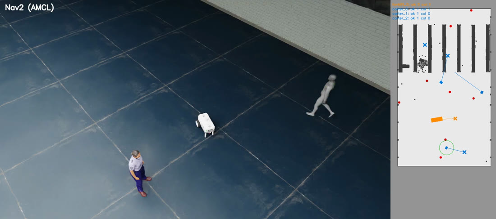
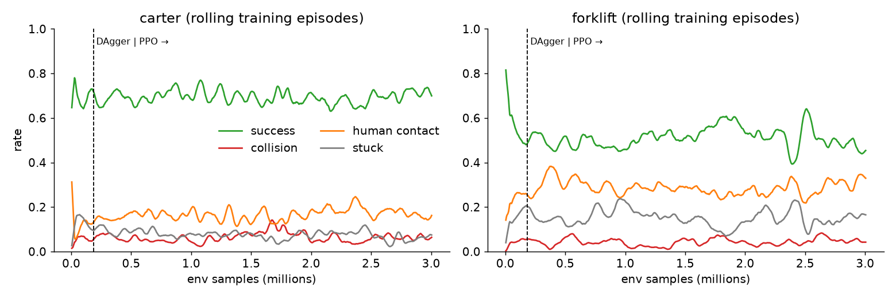
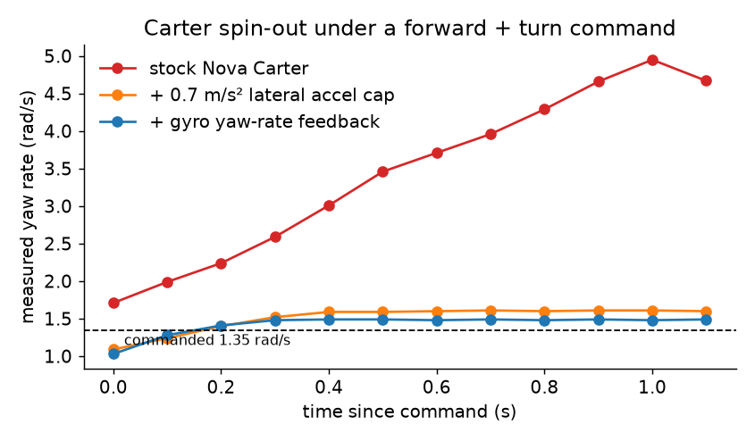
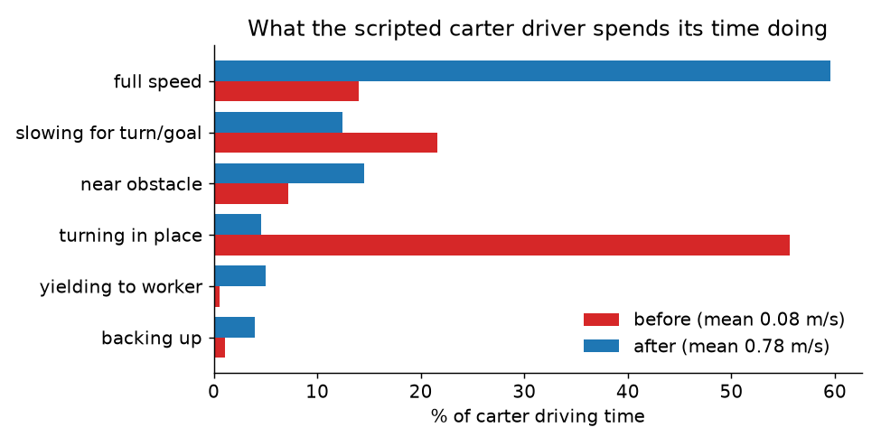
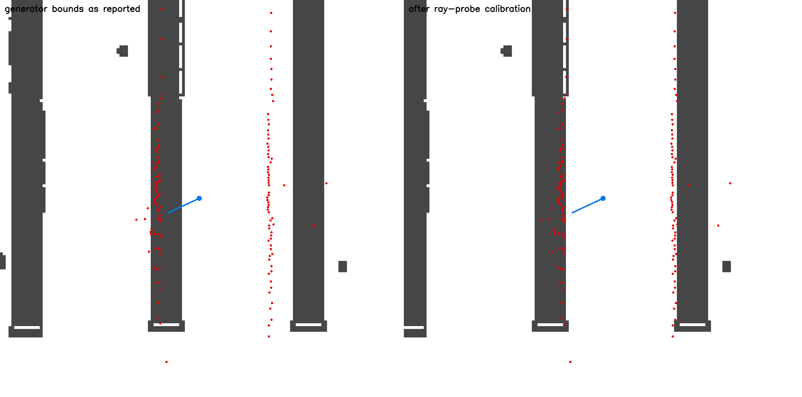
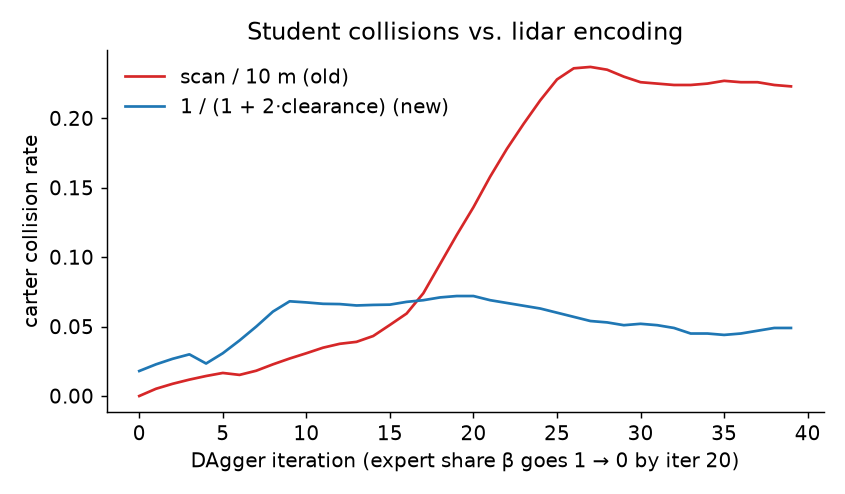
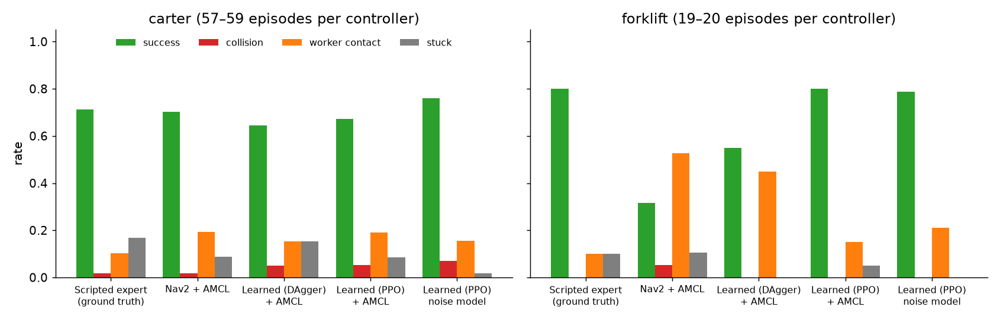

# Warehouse robots in Isaac Sim: a learned driver vs. Nav2



## The short version

I built a warehouse in Isaac Sim 6.1 with walking workers, a ForkliftC and three Nova Carters. I trained one
small network to drive both robot types using only what a real robot would have: a noisy 2D lidar, wheel
odometry and a pose estimate. Then I ran it against Nav2 on the same fixed set of start/goal pairs, with
real AMCL localization for both.

How it came out:

- **Carter:** basically a tie on success. Nav2 got to the goal 70% of the time and the learned policy 67%
  (with about 58 episodes each, anything within roughly ±12 points is noise). The learned policy was much
  faster, though: 15.5 s per successful trip against Nav2's 39.8 s.
- **Forklift:** a clear win for the learned policy, 80% against 32%. Nav2 on the forklift ran into
  workers in over half of its episodes.
- Both were localized by the same AMCL setup, and both ended up with a median localization error of
  about 0.13 m.

Most of the time on this project didn't go into the RL. It went into finding out the sim was lying to me in
four different ways. Those are the most useful part of this writeup, so they get their own section.

## What's in the sim

- **Scene:** `Isaac/Environments/Simple_Warehouse/full_warehouse.usd`, roughly 36 m × 75 m with racks,
  pallets, cones and signs.
- **Workers:** 8 people on Isaac Replicator Agent "wander" routines. They don't see the robots and won't
  step aside, which is a pessimistic but useful assumption.
- **Robots:** 1 ForkliftC (Ackermann steering, rear-wheel steer, 2 m/s) and 3 Nova Carters (differential
  drive, 1.5 m/s) in the benchmark scene. Training used 6 servers × (2 forklifts + 4 Carters) = 36 robots
  across 6 GPUs.
- **Sensors:** a 180-beam, 20 m planar lidar per robot (several mount heights flattened into one scan),
  with 2 cm range noise and 0.5% dropouts. Wheel odometry has a ±2% scale bias plus noise. Everything runs
  at 10 Hz control.

The scene ships in pieces: `warehouse_env.py` holds the environment, `warehouse_sim.py` serves it over a
socket, and `nav2_bridge.py` exposes each robot to ROS 2 Jazzy as `/<robot>/scan`, `odom`, `tf` and
`cmd_vel`.

## How the learned driver is trained

It's a teacher/student setup:

1. **The teacher** is a hand-written driver that cheats. It knows its exact pose, follows a geodesic path on
   the map, and sees every worker's true position and velocity, so it can predict where people will be in
   the next 2.5 s and yield.
2. **The student** is a 256×256 MLP that sees only the sensor stuff: 90 lidar bins now plus 90 from 0.3 s
   ago, odometry velocity, the goal direction and path direction from its *estimated* pose, and its last
   action. There's no worker ground truth anywhere in its input.
3. **DAgger** for 40 iterations (about 190k samples, 15 minutes): the student drives, the teacher labels
   what it would have done, and we regress onto that. The teacher's share of the driving decays from 100%
   to 0 over the first 20 iterations, so the student learns to recover from its own mistakes.
4. **PPO** for another 2.8M samples (about 3.5 hours), using a critic that also gets privileged state. A
   behaviour-cloning term toward the teacher keeps it from forgetting what it learned. The reward is
   progress along the geodesic, minus penalties for crowding workers and −10 for collisions or worker
   contact.

During training, localization noise comes from a simple model (a slowly drifting pose error of about 10 cm
and 2°). At test time I also run the same network with its pose coming from real AMCL instead.



To be honest about that chart: PPO barely moved the needle after DAgger. Carter success hovers around 70%
the whole way. What PPO did buy was fewer stuck episodes and a better forklift on the benchmark (DAgger alone
got 55% on the forklift, PPO 80%). It did not produce some big jump.

## The Nav2 side

This is stock Nav2 Jazzy (1.3.13), configured per robot:

- **Carter:** NavFn planner with the MPPI controller (DiffDrive).
- **Forklift:** Smac Hybrid-A\* planner (Reeds-Shepp, 1.97 m minimum turning radius) with MPPI (Ackermann).
- **Both:**
  - Rectangular footprints, inflation set to the robot's circumscribed radius plus 5 cm.
  - An obstacle layer fed from the lidar.
  - AMCL against a static map.
  - The velocity smoother and the collision monitor.

The bridge runs the sim in real time so Nav2's timers behave.

One thing I added that the stock config doesn't turn on is a **slowdown zone** in the collision monitor. It
cuts speed to 40% whenever anything is within 0.8 m ahead or 0.4 m to the side. That's the standard setup
when robots share space with people. Without it, Nav2 Carters hit workers in about half their episodes.

## Benchmark rules

- **Fixed episodes:** 20 start/goal pairs per robot, generated from a fixed seed, so every controller sees
  the same trips.
- **Held starts:** a start is held until no worker is within 2 m of it. If a worker parks there for a full
  minute, the episode is skipped and the skip is counted; each run skipped 1 to 4 episodes.
- **Worker contact** only counts against the robot if it was moving faster than 0.15 m/s at the time. A
  worker walking into a parked robot isn't the robot's fault.
- **Collision** means the robot's footprint came within 3 cm of anything that isn't a person.
- **Stuck** means no progress toward the goal for 20 s.
- **Timeout** is 150 s. Nothing actually hit it.

## The four things that were broken

### 1. The Nova Carter spins out when it turns at speed

The scripted Carters were weirdly slow: 70–130 s for trips the forklift did in 10–20 s. I recorded one, and
it was doing a kind of drunken zig-zag. It turned toward the path, overshot by 90°, stopped, spun back, and
did it again.

The wheel joints were tracking their velocity targets perfectly. The chassis itself was sliding: under a
forward-plus-turn command, the yaw rate kept climbing to over 3× what the wheel speeds should produce. More
friction didn't fix it. Neither did smaller physics steps or more caster damping.



What did fix it is what a real base controller does anyway:

- **Cap lateral acceleration at 0.7 m/s².** Above that, the robot trades speed for turn rate.
- **Close the loop on the gyro.** The wheel command gets corrected by the measured yaw-rate error.

Both live in the actuator layer, so the teacher, the learned policy and Nav2 all drive under the same
limits. The teacher's average Carter speed went from 0.08 m/s to about 0.75 m/s.



That chart also includes a second, smaller fix. The teacher used to brake whenever anything was within a
±35° cone ahead, and in a 3 m aisle that cone always clips a shelf. It now only looks at the corridor the
robot will actually sweep.

### 2. The occupancy map was 0.7 m off

AMCL on Nav2 was reporting 0.45–0.8 m of error, and it got worse the longer a trip went. In other words, it
was just following odometry drift. I plotted lidar hits on top of the map and found the hits consistently
landing 0.3–0.7 m away from the map's walls.

The cause turned out to be the `isaacsim.asset.gen.omap` generator. The bounds it reports and the buffer it
returns disagree by about 7 cells in x. Everything downstream inherited that offset: the teacher's planning
map, Nav2's map, AMCL, and the episode generator.

So the map builder now calibrates itself. It casts PhysX rays from a few hundred open cells in ±x and ±y,
compares the hit distances to where the map says the walls are, and shifts the origin to match. It lands on
−0.7 m every time.



On the left, the hits float in the aisle next to one rack and sit inside the other. On the right, they sit
right on the rack faces. Carter scan-to-map agreement went from 42% to 91% of beams. Nav2's AMCL error
dropped from about 0.5 m to a median of 0.13 m. This also fixed a lot of the teacher's shelf scrapes,
because its paths had been hugging one side of every aisle.

While I was in there, I also gave AMCL a map that matches what each robot's lidar can actually see. That's
the slice at the lidar's mount heights, which is what you'd get from running SLAM with that sensor. The
planners still use the full-height map, which includes the overhanging pallet loads.

### 3. The student couldn't see close obstacles

In the first full training run, the student's Carter collision rate climbed from 2% to 22% as the teacher
handed over control. Meanwhile its "stuck" rate fell to almost nothing. So it wasn't learning to stop; it
was learning to push through.

The lidar bins had been scaled as `clearance / 10 m`. That makes the difference between 5 cm and 30 cm from
a rack about 0.025 in input space, which is nothing. Switching to `1 / (1 + 2·clearance)` spends most of the
input range on the first metre, and the collision rate dropped to about 5%.



### 4. My first benchmark numbers were too optimistic

After the fixes above, I ran 8 episodes per robot, which comes to 23 Carter episodes per controller. It
looked great: learned + AMCL succeeded 78% of the time and Nav2 57%. With 20 per robot (about 58 Carter
episodes), the gap on the Carter disappeared. If you only take away one boring lesson from this, it's that
a navigation benchmark with fewer than about 50 episodes per cell can't tell 60% from 75%.

## Results

20 episodes per robot, same episodes for every controller, starting from the same scene seed.

**Carter** (57–59 episodes each):

| controller | success | collision | worker contact | stuck | time to goal | closest worker (p10) |
|---|---|---|---|---|---|---|
| Scripted teacher (ground truth) | 71% | 2% | 10% | 17% | 20.7 s | 0.06 m |
| **Nav2 + AMCL** | **70%** | 2% | 19% | 9% | 39.8 s | 0.21 m |
| Learned, DAgger only + AMCL | 64% | 5% | 15% | 15% | 15.0 s | 0.32 m |
| **Learned, DAgger + PPO + AMCL** | **67%** | 5% | 19% | 9% | 15.5 s | 0.32 m |
| Learned, DAgger + PPO, noise model | 76% | 7% | 16% | 2% | 16.7 s | 0.33 m |

**Forklift** (19–20 episodes each):

| controller | success | collision | worker contact | stuck | time to goal | closest worker (p10) |
|---|---|---|---|---|---|---|
| Scripted teacher (ground truth) | 80% | 0% | 10% | 10% | 18.9 s | 0.21 m |
| **Nav2 + AMCL** | **32%** | 5% | 53% | 11% | 30.1 s | 0.23 m |
| Learned, DAgger only + AMCL | 55% | 0% | 45% | 0% | 9.9 s | 0.27 m |
| **Learned, DAgger + PPO + AMCL** | **80%** | 0% | 15% | 5% | 10.9 s | 0.32 m |
| Learned, DAgger + PPO, noise model | 79% | 0% | 21% | 0% | 11.8 s | 0.31 m |



AMCL localization error over the episodes:

| | Carter | Forklift |
|---|---|---|
| Nav2 + AMCL | median 0.13 m, mean 0.17 m | median 0.07 m, mean 0.11 m |
| Learned + AMCL | median 0.13 m, mean 0.23 m | median 0.11 m, mean 0.18 m |

The learned policy's mean is pulled up by a few episodes where AMCL lost track for a while (one hit
0.76 m), and the policy just keeps driving on the bad estimate.

### What I read into this

- **On the Carter, Nav2 is a perfectly good baseline.** It's slower because it's careful: MPPI plus the
  slowdown zone means it crawls around people and in tight aisles. The learned driver is more than twice as
  fast for the same success rate, but it also scrapes things more often (5% collisions against 2%).
  Whether that trade is worth it depends on the site.
- **The forklift is where the learned policy earns its keep.** A Reeds-Shepp planner plus MPPI on a 1.6 m
  wheelbase is slow to react, and with people who walk wherever they like, it keeps getting caught
  mid-maneuver. The learned forklift has been through thousands of those encounters in training, and it's also
  a lot quicker (about 11 s per trip against 30 s), so it spends less time in people's way to begin with.
- **Swapping the training noise model for real AMCL costs about 9 points on the Carter (76% → 67%) and
  nothing on the forklift.** That gap is the sim-to-real-ish gap for localization, and it's the next thing
  I'd attack, for example by training with the AMCL pose itself or adding AMCL-style failure modes to the
  noise model.
- **The teacher isn't an upper bound.** It gets stuck 17% of the time on the Carter, and the student,
  which learned to recover from its own mistakes, beats it with the noise model (76% vs 71%).
- **Worker contact is the biggest failure mode for every controller.** Part of that is the setup: these
  workers never yield. Even so, 15–19% is too high for anything real. Speed limits near people, or an
  explicit people detector feeding the policy, would be the first things to try.

## Videos

All of these are the same benchmark episodes. The camera follows one robot (and switches to another one when
it's done). The panel on the right is the live map: blue Carters, orange forklift, red dots for workers,
and the line from each robot shows its path to the goal. Clips run 40–90 s.

A couple of things worth watching for. In the teacher video, the Carter sits for about 15 s next to a
parked forklift it can't figure out how to get around. That's the teacher's 17% stuck rate in action.
Near the end of the Nav2 Carter video, the robot gets wedged against a rack end and times out on progress.

**Learned policy + AMCL, following a Carter**


**Nav2 + AMCL, following a Carter**


**Learned policy + AMCL, starting on the forklift.** The forklift finishes its three trips in about 10 s,
then the camera hands off to a Carter.


**Nav2 + AMCL, following the forklift.** It's black for a moment while the forklift is parked between
episodes.


**The scripted teacher, following a Carter**


## Caveats

- One warehouse, one worker behaviour, one map. The policy has never seen any other layout, so don't expect
  it to generalize to a different building without training on more of them.
- Workers that never yield make worker contact look worse than it would be with real people. On the other
  hand, real people (legs, carts, hi-vis vests) are messier on a planar lidar than these simulated colliders.
- I tuned Nav2 the way I'd set it up for a first deployment, not exhaustively. Someone who lives in Nav2
  could probably get the forklift's worker-contact rate down. The slowdown zone alone took Nav2 Carters from
  35% to 57% success in an earlier run, so configuration matters a lot.
- SPL (success weighted by path length) came out almost equal to the success rate, because the geodesic is
  measured to the goal centre and runs are allowed to stop short of it. I left it out of the tables.

## What's next

Pallet handling for the forklift: approach a pallet, line the forks up, pick it up and carry it to a drop
zone. The navigation stack above is the base for it.

## Reproducing

```bash
cd ~/isaacsim
# one sim server per GPU (training uses 6 of these on ports 47810-47815)
./python.sh tools/warehouse_amr/warehouse_sim.py serve --gpu 5 --robots forklift,carter,carter,carter \
    --address 127.0.0.1:47800

# train (DAgger then PPO)
~/.venvs/franka-policy/bin/python tools/warehouse_amr/train_ppo.py train \
    --address 127.0.0.1:47810,...,127.0.0.1:47815 --run ~/warehouse_amr/runs/sensor4 --total-steps 3000000

# benchmarks (20 episodes per robot)
~/.venvs/franka-policy/bin/python tools/warehouse_amr/train_ppo.py eval --checkpoint expert --episodes 20 \
    --out ~/warehouse_amr/bench/final/expert.json
tools/warehouse_amr/ros_env.sh python3.12 tools/warehouse_amr/nav2_bridge.py nav2 --episodes 20 \
    --out ~/warehouse_amr/bench/final/nav2.json
tools/warehouse_amr/ros_env.sh python3.12 tools/warehouse_amr/nav2_bridge.py policy \
    --policy ~/warehouse_amr/runs/sensor4/policy.npz --episodes 20 --out ~/warehouse_amr/bench/final/ppo_amcl.json
# add --record out.mp4 --follow <robot index> to any of these for a video

# figures
~/.venvs/franka-policy/bin/python ~/warehouse_amr/report/make_figures.py training encoding spinout expert final
```

Raw results are in `~/warehouse_amr/bench/final/*.json` (per-episode records plus summaries). Training logs
and checkpoints are in `~/warehouse_amr/runs/sensor4/`.
