# Rebuilding the warehouse from what the robots saw

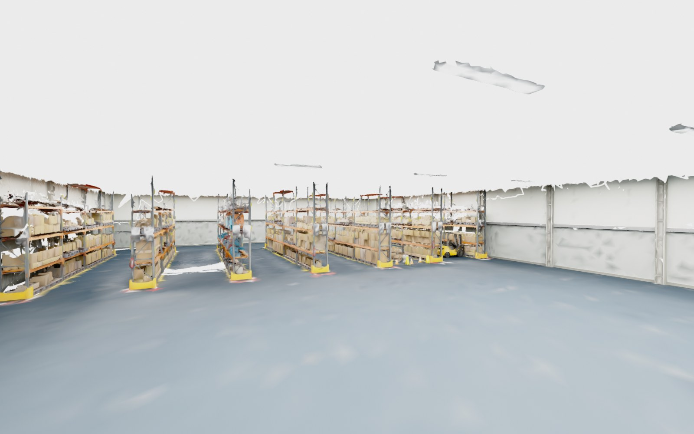

## The short version

I drove the fleet (four Nova Carters and the ForkliftC) around the Isaac Sim warehouse, logged everything
their sensors picked up, and fused it into a colored 3D model. I did this twice.

**Round one** was the easy mode: the sim's exact robot poses and perfect rendered depth. It came out very
accurate where it had geometry (2.2 mm median error), but it only covered the bottom 3 m of the building and
it fell apart once I swapped in the robots' own pose estimates.

**Round two** is the realistic version, and it's the one to use:
[`warehouse_recon_v2.glb`](../warehouse_recon_v2.glb) (146 MB, 1.25M triangles plus 7.5M colored lidar
points) and [`warehouse_recon_v2_lite.glb`](../warehouse_recon_v2_lite.glb) (16 MB).

- **No ground truth goes in.** The poses come from a multi-robot pose graph built from wheel odometry and
  lidar scan matching, and the depth comes from running FoundationStereo on the Hawk left/right pairs. The
  lidar has range noise.
- **The SLAM is basically perfect here.** Median pose error is 2.9 mm and the worst capture out of 20,228 is
  1.5 cm off. Building the model with SLAM poses scores the same as with the true poses, to within 0.1 point
  on every metric.
- **Stereo is now the limit.** 75% of the surface is within 2 cm of the truth and 89% within 5 cm (round one
  had 96% and 99.6% with perfect depth). The misses are mostly the edges of thin rack uprights and the
  stuff seen from far away.
- **It covers a lot more of the building.** A camera on the forklift's mast sees the high racks and the
  roof, so whole-building completeness went from 46% to 64% (within 5 cm), and above 3 m from almost
  nothing to 69% (within 10 cm).


## Round two: doing it without the cheats

At the end of round one I listed four things I'd do next. I did all four:

1. Multi-robot pose-graph SLAM, so the true poses aren't needed.
2. Stereo depth from the actual left/right images instead of rendered depth, plus lidar range noise.
3. Goals pushed into the aisles, and a camera on the forklift's mast for the high racks.
4. The lidar folded into the mesh itself.

Then I spent a while making the result as good as I could. Here's how each piece went.

### New data

I re-collected everything, because round one didn't have the forklift cameras, the right-hand stereo
images or the exploration goals. That's seven runs (seeds 21–27) on seven GPUs, 10 minutes of sim time
each:

| | Round one | Round two |
|---|---|---|
| Captures | 11,815 | 20,228 |
| Camera frames (RGB + stereo pair + depth) | 37,792 | 76,874 |
| Lidar sweeps (XT-32 or forklift planar) | 11,815 | 20,228 |
| Disk | 8.8 GB | 66 GB |

One run (seed 22) died partway through with a GPU out-of-memory error, because the stereo inference I'd
started on the same card ate the memory. I kept its 2,448 captures.

**The forklift mast camera.** The ForkliftC now carries three stereo cameras at 2.22 m: one looking forward
and tipped up 10°, and two looking left and right, tipped up 30°. That's what sees the upper shelves, the
tops of the racks and the roof.

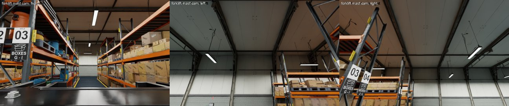

**Goals into the aisles.** New goals now go to the least-visited part of the floor 80% of the time. That
helped less than I hoped: visited 1 m cells went from 1,213 to 1,314. The forklift is too wide for the rack
aisles, so it never goes in. It stays on the cross aisles, and its side cameras look down the rack faces
from the ends. The Carters do go into the aisles.

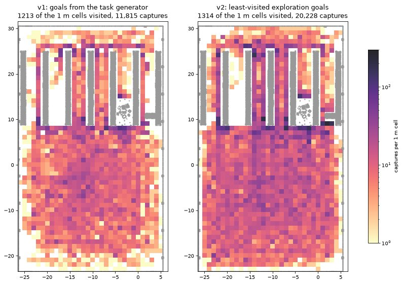

### SLAM

`slam.py` builds one pose graph over all seven runs and all five robots at once:

- **Nodes** are the captures, one 2D pose (x, y, yaw) each.
- **Odometry edges** link consecutive captures of the same robot. Their uncertainty grows with distance and
  turning.
- **Scan-matching edges** come from point-to-plane ICP between lidar sweeps (XT-32 for the Carters, the
  three planar layers for the forklift). That's first between neighbors in time (one and two captures
  apart), then three rounds of loop closures against random captures from any robot or run within 3, 2 and
  then 1.5 m. Each match has to pass a fitness and RMSE gate, and a Cauchy robust kernel takes care of the
  bad ones that get through.
- **Priors** from each robot's own pose estimate (the localization noise model, about 12 cm), with a loose
  0.3 m / 5° weight.

The whole thing is solved with Gauss–Newton. It ended up with 218k loop closures, 97% of them between
different robots or different runs, which is what ties everything into one map.

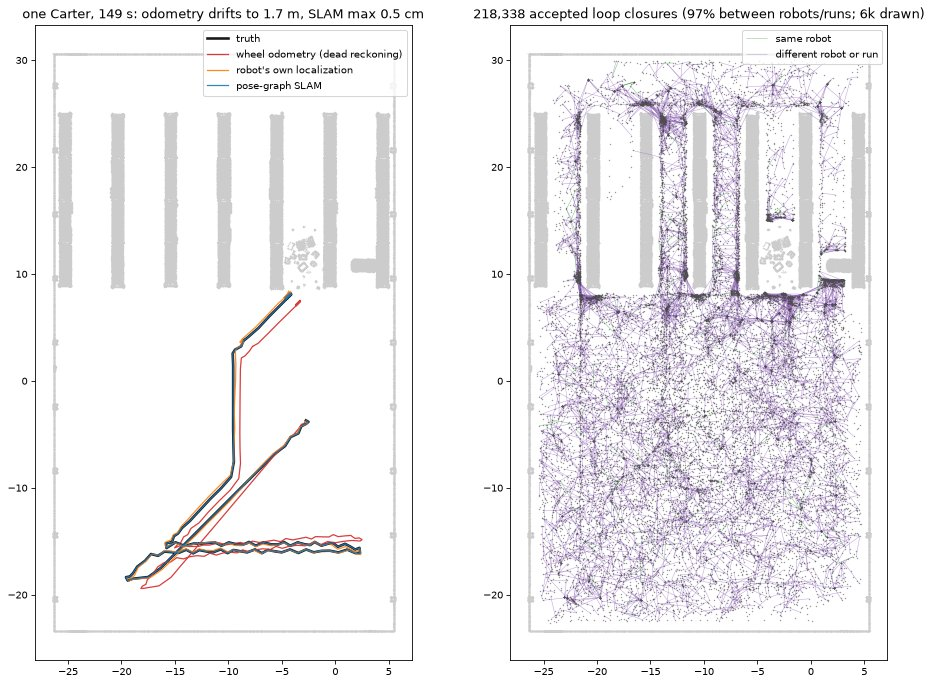

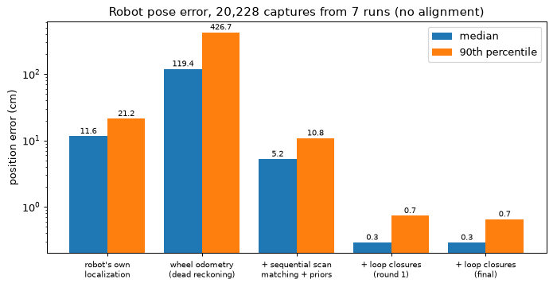

| Stage | Median pose error | 90th percentile | Max |
|---|---|---|---|
| Wheel odometry alone | 1.19 m | 4.27 m | 17.8 m |
| + sequential scan matching | 5.2 cm | 10.8 cm | 41 cm |
| + loop closures (final) | **2.9 mm** | **6.5 mm** | **1.5 cm** |
| (the robots' own estimates, for reference) | 11.6 cm | 21 cm | |

For comparison, round one's map-based ICP stalled at 11.6 cm on the full set.

**Without the priors it doesn't work.** If I drop the localization priors and just pin the first pose of
each robot, the median is still 5 mm. But 968 captures (4.8%) end up more than half a meter off, because
some scan matches got trapped in the wrong aisle. The racks all look alike, and with nothing pulling those
captures back, the model gets ghost racks (median surface error 1 m). Fixing that needs real place
recognition, which I didn't build.

### Stereo depth

Each Hawk is a 15 cm-baseline stereo pair, so I ran FoundationStereo (the ViT-L checkpoint, 12 refinement
iterations) on every left/right pair on six GPUs. That works out to about 2.2 pairs/s per process. On top
of the raw output I throw away disparities under 2 px, the strip on the left edge the right camera can't
see, flying pixels at depth jumps, and anything past 30 m.

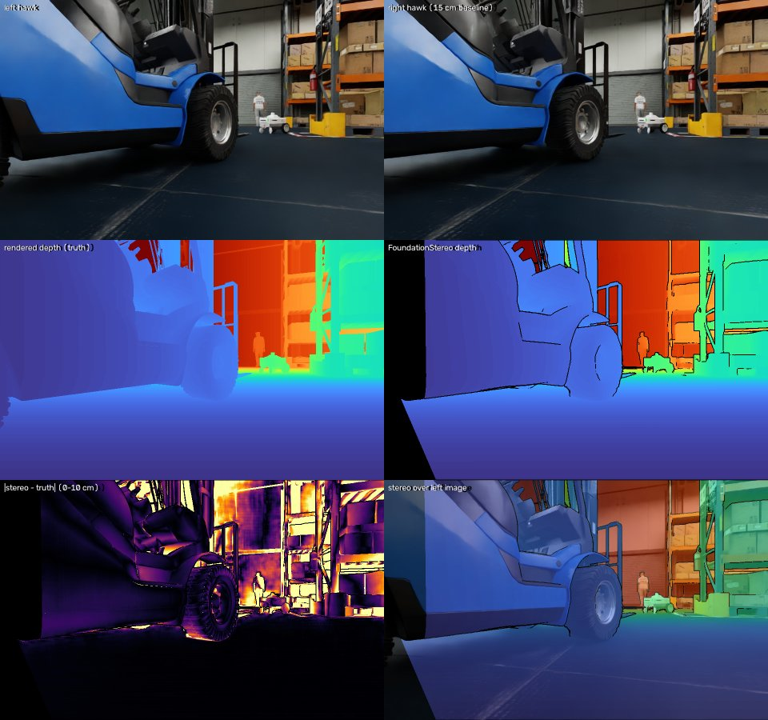

It's very good up close and gets worse with the square of the distance, as stereo always does:

| Distance | Median error | 90th percentile |
|---|---|---|
| 0–2 m | 0.1–0.2 cm | 0.8–1.6 cm |
| 3–4 m | 1.0 cm | 4.7 cm |
| 5–6 m | 2.6 cm | 10 cm |
| 6–8 m | 3.9 cm | 13 cm |
| 10–12 m | 7.1 cm | 25 cm |
| 20–25 m | 30 cm | 1.0 m |

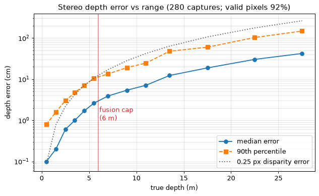

It's unbiased, but within 6 m about 4.4% of pixels are off by more than 5 cm. Almost half of those sit on
depth edges, mostly rack uprights against a far background, where the depth smears from the upright into
the space behind it.

For the lidar I added 1.5 cm of Gaussian noise along each ray. The
noise is deterministic per capture and beam, so reruns match.

### Getting a clean mesh out of stereo

Swapping perfect depth for stereo with the same settings as round one gave 84% of the surface within 5 cm,
and lots of junk: floaters in the aisles and sheets hanging off the racks. Three changes got it to 89% while
also covering more of the building:

- **Layered depth.** The main volume only takes stereo out to 4 m, where it's accurate, at 2 cm voxels. A
  second, coarser volume (4 cm voxels) takes 4–8 m, and only adds surface where the near layer has nothing
  within 8 cm. That way close-up views decide the geometry and far views just fill holes.
- **A free-space filter.** Every vertex gets reprojected into every camera within 12 m. If more rays pass
  straight through where it is than land on it, it's a floater and it goes. That removed 31% of vertices,
  almost all junk.
- **Recoloring from the images.** The TSDF averages color across every frame that touches a voxel, so
  far-away, blurry views washed the racks out to a pale gray. At the end I recolor every vertex directly
  from the images that see it (depth has to agree), weighting close views by 1/z². Anything nobody saw
  within 8 m gets a second pass out to 25 m.

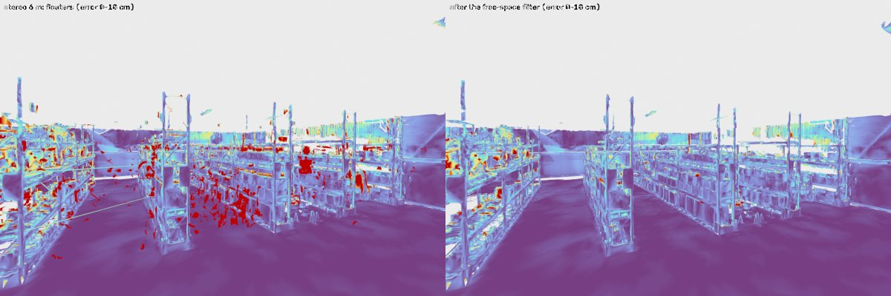

### Folding the lidar in

I turned each XT-32 sweep into four virtual 90° depth images and fused them as a third layer behind the two
camera layers, only filling gaps.

It barely matters. It adds about half a point of completeness and costs about a point of accuracy, because
lidar surfaces are lumpier than stereo at close range. The reason is that the XT-32 sits low on the Carter
and only looks up to +15°, so within its 20 m reach it never sees anything above about 5.8 m. Everything
it does see, the Hawks have usually already seen up close. All the high stuff comes from the forklift's mast
cameras:

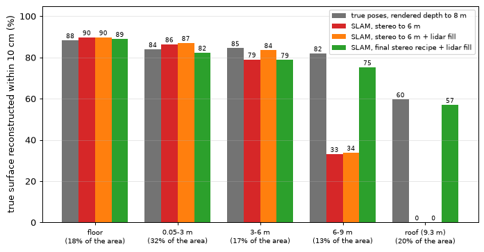

I left it on in the final model since it's slightly more complete, but it's not where the win is.

### Ablation

Each row changes one thing. "Accuracy" is the share of the reconstructed surface within 5 cm of the truth,
and "completeness" is the share of the true surface with reconstruction within 5 cm (10 cm for the
above-3 m column). The top two rows use perfect rendered depth and true poses, so they're upper bounds, not
something a real fleet could do.

| Run | Poses | Depth | Median error | Accuracy (5 cm) | Completeness, whole building | Completeness above 3 m (10 cm) |
|---|---|---|---|---|---|---|
| Upper bound | true | rendered | 0.34 cm | 99.6% | 71.2% | 73.8% |
| Upper bound + lidar | true | rendered | 0.35 cm | 97.5% | 71.7% | 74.5% |
| Robots' own poses | est. (12 cm) | stereo | 20.5 cm | 31.6% | 31.6% | 23.3% |
| SLAM, no priors | SLAM | stereo | 100 cm | 26.4% | 51.2% | 34.8% |
| SLAM, round-one recipe | SLAM | stereo | 0.57 cm | 83.9% | 52.5% | 34.8% |
| + lidar fill | SLAM | stereo | 0.67 cm | 82.5% | 53.4% | 36.5% |
| Same with true poses | true | stereo | 0.60 cm | 82.6% | 53.3% | 36.5% |
| **Final** (layered, free-space, 8 m) | **SLAM** | **stereo** | **0.60 cm** | **88.9%** | **64.0%** | **69.0%** |
| Final with true poses | true | stereo | 0.58 cm | 89.0% | 64.1% | 69.2% |

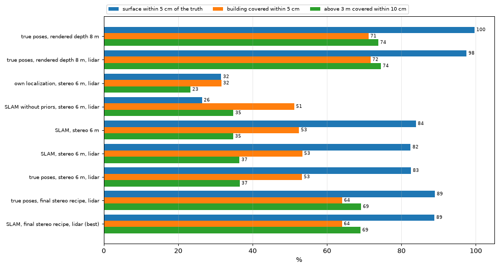

What that table says:

- **SLAM costs nothing.** Every SLAM row matches its true-pose twin to a tenth of a point.
- **Stereo costs about 10 points of accuracy and 7 of completeness** against the upper bound. The final
  run's 2 cm figure is 75% vs 97%.
- **The layering and the free-space filter were the biggest wins of the tuning:** +6.4 points accuracy,
  +10.6 points whole-building completeness, and the above-3 m coverage nearly doubled.

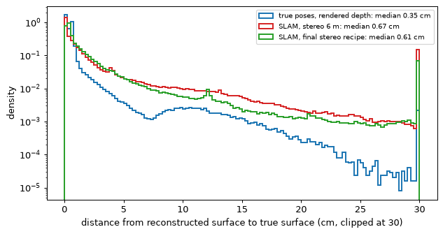

### What the final model looks like

Same viewpoints as round one, against the true geometry:

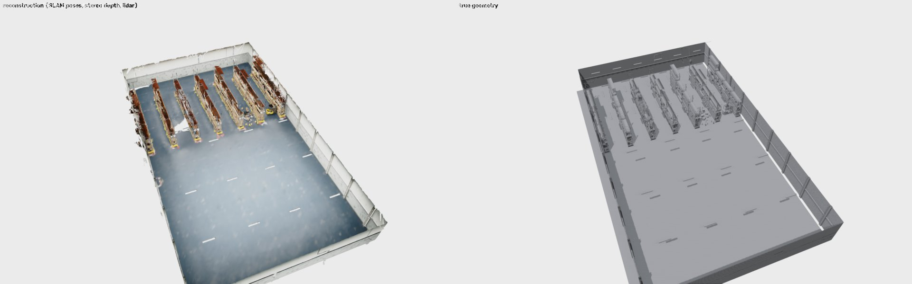

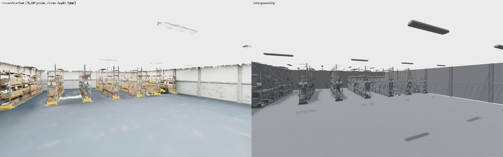

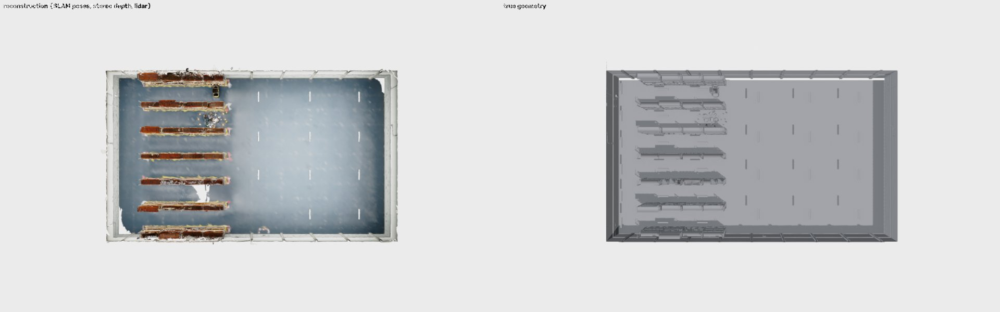

And colored by error (0 to 5 cm). Floors and walls are dark blue. The error lives on the rack uprights, the
shelf edges and the high stuff only the forklift saw from a distance.

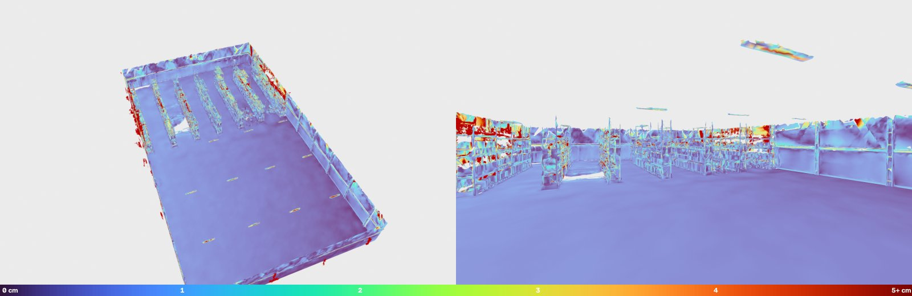

### Things that went wrong in round two

- **The stereo job and a collector shared a GPU**, and the collector ran out of memory and died (seed 22).
  I kept the partial run.
- **SciPy's sparse solver (SuperLU) stalled** on the 20k-node pose graph once the loop closures filled it
  in. CHOLMOD (`scikit-sparse`) solves it without trouble.
- **A sign error in the SE(2) inverse Jacobian** made the scan-matching edges pull the wrong way, so the graph
  got worse instead of better until I found it.
- **zsh doesn't split `$VAR` into words** like bash does, so a relaunch passed all its flags as one argument
  and quietly did nothing. Use `${=VAR}` or spell the args out.
- **Washed-out colors.** The 20 m color volume averaged in too many distant views. That's what the recolor
  pass fixes. A first version only reached 8 m and left the rack ends facing the open floor gray, hence the
  25 m second pass.
- **Weighting the free-space votes by distance** sounded like it would kill the leftover sheets on the rack
  ends. It removed another 0.8% of vertices and moved nothing, so it's off by default.

## Round one: true poses and perfect depth

Everything below is the original write-up. It's still the best description of the sensor setup and how
the fusion works, and its numbers are the upper bound in the ablation above.


### There was no data, so I collected some

The ask was to use the data we already had from the robots driving around. It turned out there wasn't
any. The navigation benchmarks only saved per-episode summaries (success, time, collisions). The lidar was a
flattened 2D scan that got thrown away every step, and the robots' cameras had never been rendered at all.

So I added a collection script (`collect_recon.py`) that drives the fleet around and logs a synchronized
capture from every robot once a second. For each capture the sim pauses, renders, reads the sensors and
then carries on, so images, depth and poses all line up exactly.

What each robot contributes:

- **Nova Carter** carries four Hawk stereo cameras (front, left, right and back, each with a 90° field of
  view), four fisheye Owl cameras, two RPLidars and a Hesai XT-32. From each Hawk I take the left camera's
  RGB image, its depth and a mask of anything that moves (people, other robots, pallets). The XT-32 gets a
  full sweep: 32 channels from -16° to +15°, 720 columns, 60 m range.
- **ForkliftC** has no cameras, so it only contributes its planar lidar layers at 0.12, 0.6 and 1.8 m.

Each capture also records the true pose, the robot's own pose estimate (the localization noise model, about
0.12 m median error) and wheel odometry.

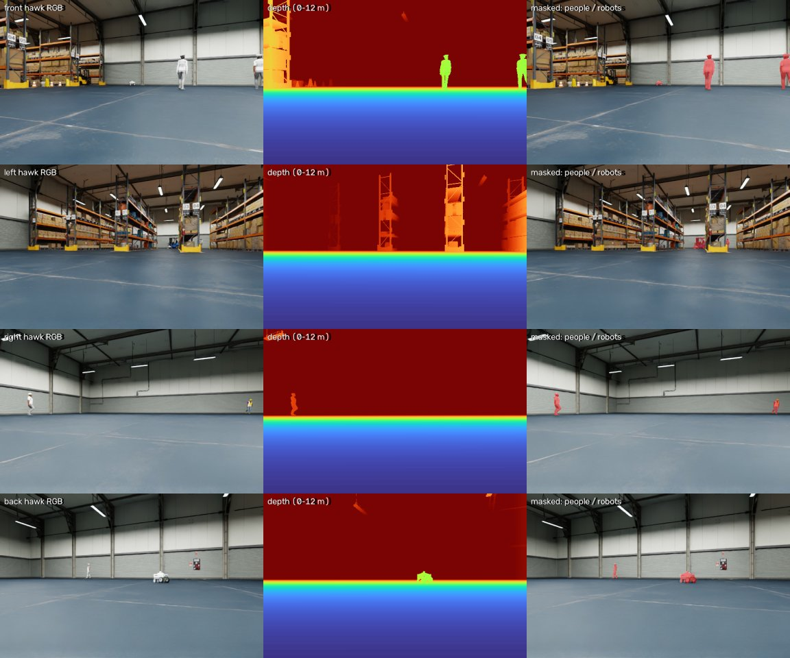

Here's what one Carter saw over about 40 seconds of driving (all four Hawks, masks in red, depth on the
right):


And here's one sweep from each lidar type. The rings around the Carter are the XT-32's downward channels
hitting the floor. Red dots are hits on people or robots, which get dropped.

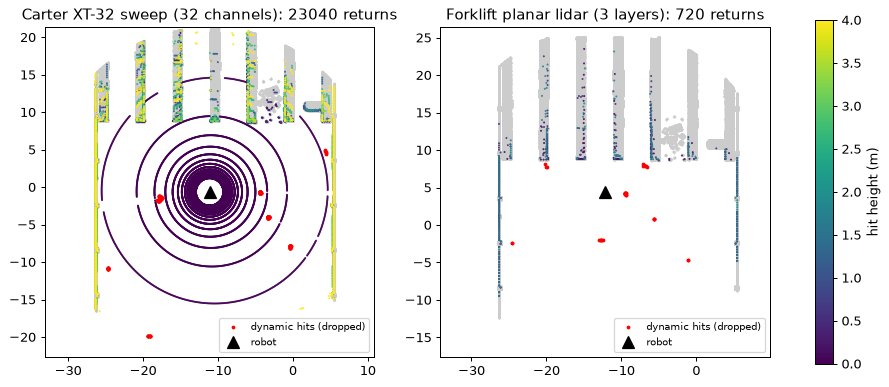

#### How much I collected

I ran four collection runs in parallel on four GPUs, each with a different seed. Each run had four
Carters, the forklift and six walking workers, and lasted 10 minutes of sim time. With rendering on the
sim manages about 0.13× real time, so each run took about 77 minutes.

| | Total |
|---|---|
| Captures | 11,815 |
| Hawk RGB-D frames | 37,792 |
| Lidar sweeps | 11,815 |
| Disk | 8.8 GB |

Robots drove random goals with the scripted expert. This is where everybody went:

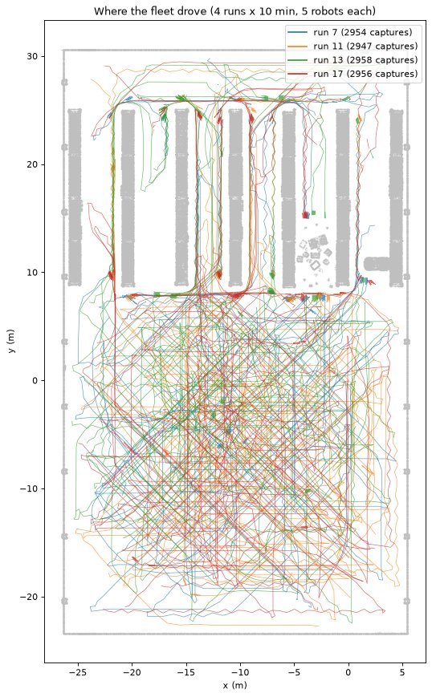

The open floor got hammered. The aisles got the forklift's laps and the odd Carter visit, and the two
outermost aisles barely got any traffic. Coverage follows that picture pretty closely.

### Building the model

The reconstruction script (`recon.py`) does this:

1. **Camera fusion.** Every Hawk RGB-D frame goes into a colored TSDF volume (Open3D) at 2 cm voxels,
   with the moving-object mask dilated a bit and cut out of the depth, and depth capped at 8 m. That's the
   standard KinectFusion-style approach: each frame votes on where surfaces are, and the votes average out.
2. **Meshing.** Marching cubes gives 23M triangles. I drop fragments under 200 triangles and decimate to 2M
   with quadric decimation, which keeps the edges of racks and boxes sharp.
3. **Lidar points.** The static lidar returns go in as a separate point layer. Carter points take the color
   of the Hawk pixel they land on, but only when the camera's depth agrees (the camera actually sees that
   surface). Forklift points and anything the cameras didn't see stay gray.
4. **Export.** A GLB with two nodes, `reconstruction` (the mesh) and `lidar_points`. It's Y-up and in
   meters, with the floor at y = 0.

Fusing all 37,792 frames takes about 25 minutes on CPU when nothing else is fighting for the cores.

### How accurate is it

Since this is a sim, I have the ground truth: the warehouse USD's actual triangles. I exported them during
collection (`gt_mesh.npz`, 677k triangles) and compared both ways:

- **Accuracy:** sample 2M points on the reconstruction and measure how far each is from the true surface.
- **Completeness:** sample 4M points on the true surface and measure how far each is from the
  reconstruction. I restrict it to surfaces below 3 m and within about 5.6 m of somewhere a camera went,
  since nothing on the roof was ever in view.

| Metric | Result |
|---|---|
| Median error | 2.2 mm |
| Mean error | 4.9 mm |
| 90th percentile error | 1.1 cm |
| Within 2 cm / 5 cm | 96.0% / 99.6% |
| Completeness of the visible region (within 5 cm) | 74.6% |
| Completeness of the whole building (within 5 cm) | 46.4% |

Side by side with the true geometry, from the same viewpoints (I cropped the truth at 6 m to take the
roof off):

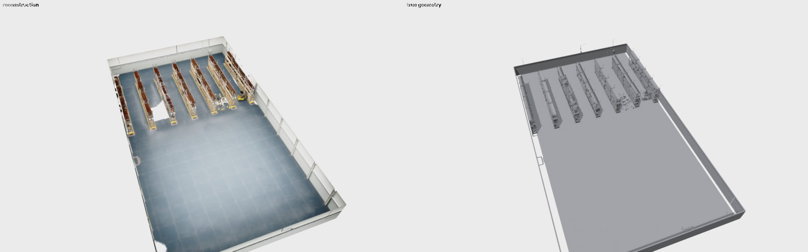

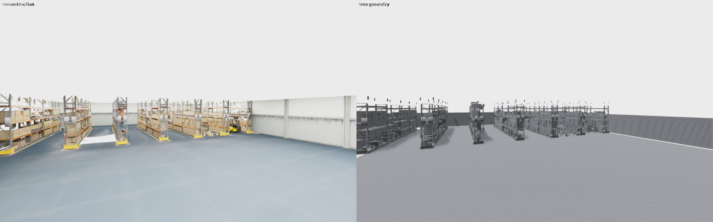

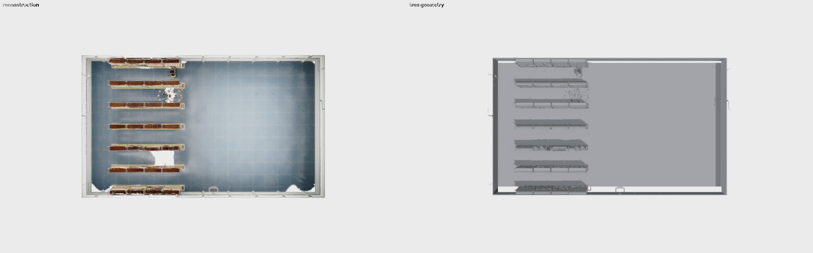

This is the reconstruction colored by its distance to the truth. Dark blue is under a centimeter. The floor
and walls are basically perfect. The racks are where the 1–2 cm error lives, around thin uprights and shelf
edges, which is about one voxel and roughly what you'd expect from a 2 cm grid.

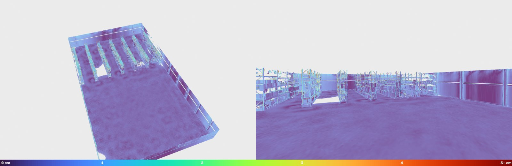

### Why the exact poses matter so much

Two honest caveats about the headline numbers:

- **The poses are the sim's true poses.** A real robot doesn't know them.
- **The depth is perfect rendered depth.** A real Hawk gives stereo depth, which gets noisy with distance
  (roughly 5 cm at 3 m for this baseline).

To see what the first one costs, I reran the fusion with each robot's own pose estimate instead. That's
the same localization noise model the navigation policies were trained against: about 0.12 m and 2°,
wandering slowly over time.

It's bad:

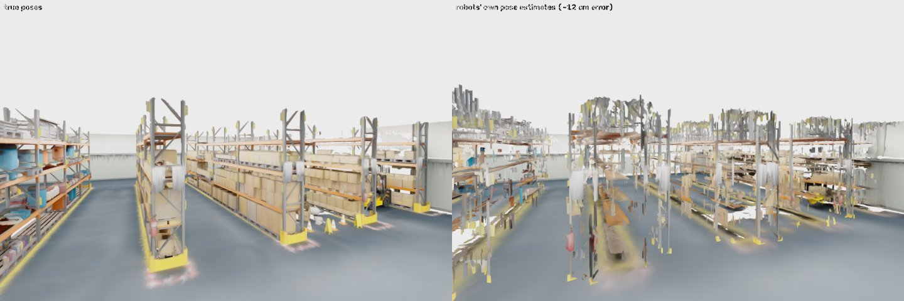

Every rack shows up two or three times, slightly shifted, because each robot thought it was somewhere a
little different every time it drove past. The raw mesh doubles in size (47M triangles) because of all the
ghost surfaces.

| | True poses | Robots' own estimates |
|---|---|---|
| Median error | 0.2 cm | 10.7 cm (17.7 cm before a rigid alignment to the truth) |
| 90th percentile error | 1.1 cm | 82 cm |
| Within 2 cm | 96% | 35% |
| Completeness of the visible region | 75% | 47% |

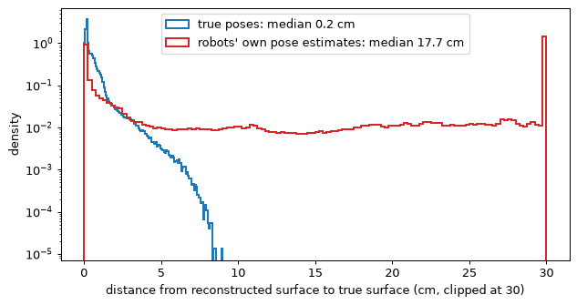

12 cm of localization error is fine for driving down an aisle. For mapping it's a disaster, because the
error is in the same ballpark as the features you're trying to map.

#### Trying to fix the poses with the lidar

The obvious fix is to let the robots correct themselves by aligning each lidar sweep against the map. I
built a simple version of that into `recon.py` (`--poses est_icp`):

1. Start from the robot's own pose estimate.
2. Build a map from the *other* robots' sweeps. If a sweep is aligned to a map that contains itself, it
   doesn't move at all, which was my first bug.
3. Align each sweep to that map with point-to-plane ICP, keeping only x, y and yaw.
4. Rebuild the map with the corrected poses and repeat, tightening the matching radius each pass.

On 600 captures it works well. On all 11,815 it doesn't:

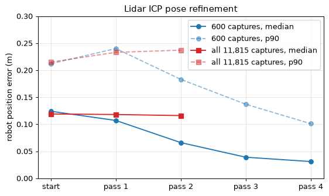

- **600 captures:** median pose error 0.124 m to 0.031 m in four passes, and the 90th percentile 0.21 m to
  0.10 m.
- **All 11,815:** 0.119 m to 0.116 m after two passes, at 24 minutes per pass. I stopped it there.

My read on why: with thousands of noisy sweeps, the map's walls and racks get smeared into slabs 20 cm
thick, and a sweep fits fine anywhere inside the slab, so ICP has nothing pulling it to the right spot.
With fewer sweeps the map is sharper and the alignment has something to grab. The proper fix is real
multi-robot SLAM:

- use the wheel odometry between consecutive captures (very accurate over 1 s),
- match scans pairwise instead of against an averaged map,
- add loop closures where robots revisit the same places,
- and solve everything together as a pose graph.

I didn't do that in round one. Round two above does.

### Things that went wrong on the way

None of these are interesting on their own, but each one ate time and they'll bite again:

- **The Hawk cameras use a deprecated fisheye lens model** (`fisheyePolynomial`), so their images aren't
  pinhole. Separately, retargeting a render product from one camera to another crashed the annotator
  readback with a CUDA fault on the second capture. Both went away by rendering through four pinhole proxy
  cameras I own, with the Hawk's 90° field of view, moved onto each Carter's Hawk poses before each render.
- **Open3D 0.20's `ScalableTSDFVolume` returns an empty mesh**, even for a flat plane. 0.19 works. The
  `recon` venv is pinned to 0.19 for this reason.
- **Open3D's tensor `VoxelBlockGrid` segfaults when it extracts a warehouse-sized mesh on CPU.** I switched
  to the legacy volume.
- **Open3D's OpenMP runtime deadlocks in forked worker processes.** The ICP workers use `spawn` now.
- **A memory blowup.** My first parallel ICP gave each of 64 workers its own copy of an 11.5 GB map file,
  which was heading for about 740 GB of RAM on a machine that's also running the sglang server. I killed it
  in time. Workers now memory-map shared arrays from `/dev/shm`.
- **OpenMP using all 184 cores made fusion crawl** (it was spin-waiting) on this shared box. Capping it at
  32 threads made it 10–50× faster.
- **A 12 m ICP crop rejected about 15% of sweeps** because the XT-32's long returns had nothing to match.
  25 m fixed it.

Before the full collection I also sanity-checked the logging. Back-projected camera depth landed a median
0.2 mm from the true surfaces, and lidar points about 1 µm, so the pose and intrinsics bookkeeping is right.

## Caveats

- **It's still a sim.** The stereo runs on clean rendered images with perfect lighting, sharp textures and
  no motion blur, so real Hawks will do worse. The lidar noise is a simple Gaussian, with no multipath and
  no dropouts on shiny or dark surfaces.
- **The SLAM leans on the localization priors.** Without them about 5% of captures land in the wrong aisle.
  The priors come from the same noise model the navigation work used, so it's fair, but a real system would
  need place recognition to recover from a bad start.
- **The calibration is given, not estimated.** Camera and lidar mounts are fixed per robot type and come from
  the sim. Real ones would need a calibration step.
- **Moving things are masked using the sim's instance segmentation.** On a real robot that would be a
  person and robot detector, and it would miss sometimes.
- **There are still holes**: the far ends of the two outermost aisles, the backs of the rack tops nobody
  looked down on, and parts of the roof between the lights.
- **The static forklift props in the scene are in the model.** They're part of the warehouse USD, not the
  robot forklift, so that's correct.

## What I'd do next

1. **Place recognition** (scan-context style descriptors on the XT-32 sweeps) so the SLAM works without
   priors and recovers from the wrong-aisle matches.
2. **Better stereo at edges.** A left-right consistency check or a confidence output would drop most of the
   bad pixels on the uprights, and that's where most of the remaining error is.
3. **A taller or tilted lidar on the forklift**, or a longer range cap, so the lidar actually helps with the
   roof instead of being redundant with the Hawks.
4. **Landmarks in the pose graph**, like rack uprights as point features. That would make loop closures in
   the look-alike aisles much harder to get wrong.

## Files and how to reproduce

The model:

- `~/warehouse_amr/recon/warehouse_recon_v2.glb` (146 MB, 1.25M triangles plus 7.5M lidar points) and
  `warehouse_recon_v2_lite.glb` (16 MB, 300k triangles). The round-one files are `warehouse_recon.glb` and
  `warehouse_recon_lite.glb`. Obsidian won't preview GLB inline. Open them in Blender, Windows 3D Viewer,
  or drop them on <https://gltf-viewer.donmccurdy.com>.
- `~/warehouse_amr/recon/v2/out_final_slam/`: meshes, `metrics.json`, `poses.npy` and the preview renders.
  The other `v2/out_*` folders are the ablation runs. `v2/slam_poses.npy` caches the SLAM solution and
  `slam_poses_stages.json` has the per-stage errors.

Code, in `~/isaacsim/tools/warehouse_amr/`:

- `collect_recon.py`: drive the fleet and log captures (now with stereo pairs, the forklift mast cameras
  and exploration goals).
- `stereo_depth.py`: FoundationStereo on every left/right pair (runs in the `stereo` venv).
- `slam.py`: the multi-robot pose graph.
- `recon.py`: fuse, filter, recolor, evaluate and export.
- `recolor_glb.py`: redo just the coloring and the GLB export of a finished run.
- `recon_views.py`: offscreen preview renders.
- `make_media.py` and `make_media_v2.py` (in this folder) build every figure and video here.

```bash
cd ~/isaacsim
V=~/warehouse_amr/recon/v2

# collect, one run per GPU (seeds 21-27)
./python.sh tools/warehouse_amr/collect_recon.py --gpu 2 --seed 21 --steps 6000 --out $V/data_s21

# stereo depth, sharded across processes (12 shards on GPUs 2-7 here)
CUDA_VISIBLE_DEVICES=2 ~/.venvs/stereo/bin/python tools/warehouse_amr/stereo_depth.py $V/data_s2* \
    --iters 12 --shard 0/12

# SLAM + fuse + evaluate + export (Open3D 0.19 venv); recolor runs by default
~/.venvs/recon/bin/python tools/warehouse_amr/recon.py $V/data_s2{1,2,3,4,5,6,7} \
    --poses slam --slam-cache $V/slam_poses.npy \
    --depth stereo --depth-near 4 --depth-max 8 --far-voxel 0.04 --color-max 20 \
    --lidar-fuse --free-space --out $V/out_final_slam

# previews and report media
~/.venvs/recon/bin/python tools/warehouse_amr/recon_views.py $V/out_final_slam --gt $V/data_s21/gt_mesh.npz
cd ~/warehouse_amr/recon/report && ~/.venvs/recon/bin/python make_media_v2.py all
```

`run_all.sh` in `v2/` has the ablation runs. Round one's commands are the same `recon.py` call with
`--poses gt|est|est_icp` on the `data_s7/s11/s13/s17` runs, followed by `make_media.py all`.
