# Warehouse reconstruction, round three

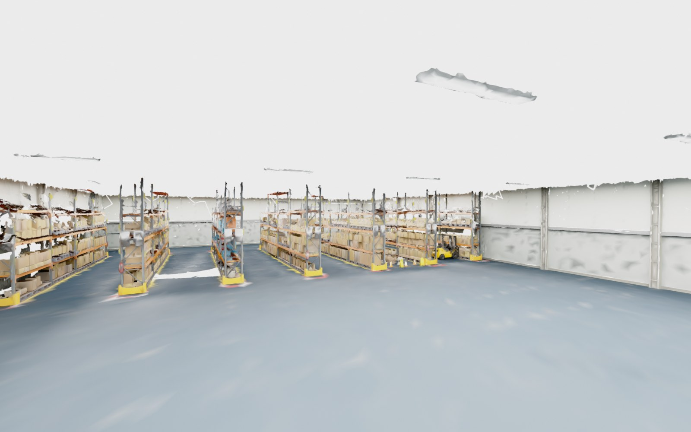

## TL;DR

Round two ended with four things I'd do next. I did all four:

1. **Place recognition, so SLAM works without priors.** Each lidar sweep gets a Scan Context descriptor.
   Candidates are verified with ICP and then checked for consistency with each other. The only prior left
   is the robot's own rough pose estimate at the start of each segment. With that, the median pose error
   is **2.5 mm** and the worst capture is 1.1 cm off. That's after dropping two tiny segments that
   never closed a loop with anything. In round two, 4.8% of captures landed more than half a meter off in
   that setup. I also tried a harder "kidnapped" mode, where only each robot's first segment in each run
   gets a start estimate and every respawn has to be found from scratch. It places 99.45% of captures, and 0.25% of
   them land in the wrong spot.
2. **A left-right consistency check on the stereo.** It works: within 4 m, the share of pixels off by more
   than 5 cm drops from 1.8% to 1.3%. In the mesh that's 1.5 points of accuracy for 1.2 points of
   coverage, so it's real but small.
3. **A tilted lidar on the forklift's mast.** It's a 64-beam, ±45° unit at 2.3 m. 39% of its returns are
   above 6 m, against 5% for a Carter's XT-32. Coverage at 6–9 m goes from 67% to 80%, at a cost of 1.4
   points of accuracy. It also made the forklift much easier to place by place recognition.
4. **Rack uprights as landmarks in the pose graph.** This one made things worse, so it's off. The pose
   graph is already at a couple of millimeters, and a pole seen by lidar can only be located to about
   4 cm.

The final model is built with **no localization priors**. 89.9% of its surface is within 5 cm of the true
geometry (median 0.58 cm), and it covers 63% of the building and 69% of everything above 3 m. That's
the same as building it from the sim's true poses (90.1%), and level with round two (88.9%), which needed
the robots' pose estimates. It's level and not better, because each improvement this round traded a
little accuracy for coverage or the other way round.

The model is `~/warehouse_amr/recon/warehouse_recon_v3.glb` (167 MB, 1.45M triangles plus 8.6M colored
lidar points), and there's a `warehouse_recon_v3_lite.glb` (20 MB) for quick looks. Obsidian can't preview
GLB, so open them in Blender or drop them on <https://gltf-viewer.donmccurdy.com>.


## New data

I re-collected everything, because the forklift needed its new lidar. That's seven runs again (seeds
31–37), 10 minutes of sim time each, with four Nova Carters, the ForkliftC and six walking workers.

| | Round two | Round three |
|---|---|---|
| Captures | 20,228 | 20,761 |
| Camera frames | 76,874 | 78,908 |
| Lidar sweeps | 20,228 Carter + forklift planar | same, plus 4,136 forklift mast sweeps |
| Disk, with stereo outputs | 66 GB | 94 GB |

The extra disk is mostly stereo, which is now stored twice: with and without the left-right check.

## The forklift's mast lidar

In round two the forklift only had three planar scanners near the floor, and the Carters' XT-32s only look
up to +15°. So the lidar never saw the high racks or the roof, and folding it into the mesh barely helped.

This time the forklift carries an OS0-style lidar on its mast, about 2.3 m up: 64 beams spread over ±45°,
512 columns and 60 m of range. It raycasts the same way as the XT-32, with the same 1.5 cm range noise.

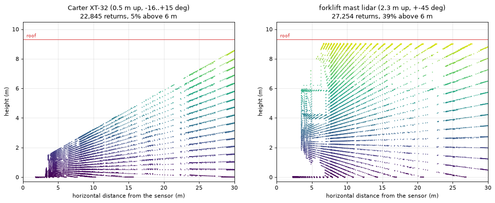

The right-hand panel is what I wanted. It sees the rack tops, the high shelves and the roof, from 4 m out
to the far wall.

It also turned out to matter for SLAM, not just for the mesh. There's more on that below.

## Place recognition

### Why round two needed priors

Round two's SLAM leaned on each robot's own pose estimate as a loose prior (0.3 m, 5°). Without it, scan
matching snapped about 5% of captures into the wrong aisle, because all the rack aisles look the same at
lidar height. A loop-closure search that only looks within 3 m of where you think you are can't recover
once you're a meter off. You need something that recognizes the place regardless of where you think you
are.

### Scan Context

Each sweep is turned into a Scan Context descriptor. That's a polar grid, 20 rings out to 30 m by 60
sectors of 6°, holding the highest return in each cell. I cap the heights at 3 m so the descriptor
describes the rack and wall layout, and the roof doesn't make every place look alike. Comparing two
descriptors means trying all 60 column shifts, so yaw doesn't matter. The shift also gives a starting
yaw for ICP.

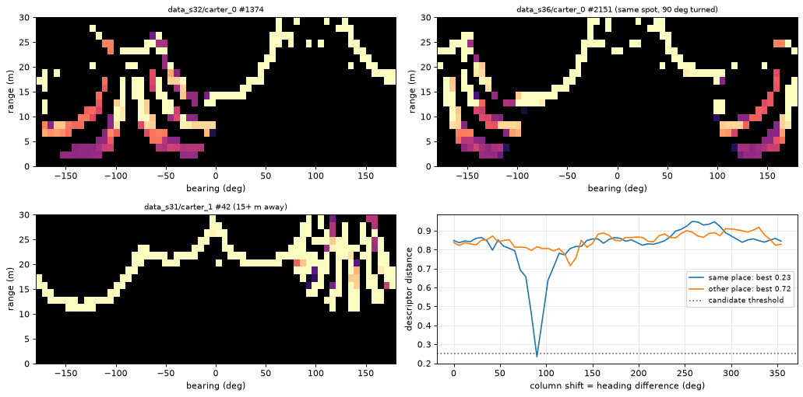

For retrieval:

1. **Shortlist.** Each ring's occupancy (the "ring key") does a cheap 25-nearest-neighbor search over all
   sweeps from every robot and run.
2. **Rank.** The full descriptor distance with the best shift ranks the shortlist, and the best two under
   0.25 are kept. Hits from the same robot within 50 captures are skipped, since sequential matching
   already covers those.
3. **Verify with ICP.** Each candidate goes through ICP from several starting offsets (±1.5 m, ±0.1 rad),
   tightening from 2 m down to 12 cm. It has to end with fitness above 0.6 and RMSE under 4 cm.
4. **Check for consistency.** This is what fixed the aliasing. Within each pair of robot segments, two
   closures are consistent if they imply the same relative offset between the segments. I keep the
   largest set of mutually consistent closures, and only if it has at least two members. A wrong-aisle
   match that passes ICP still disagrees with the correct matches around it, so it gets dropped.
5. **Check residuals.** After a solve, any closure with a residual chi² above 50 is cut, and the graph
   is solved again.

| Step | Closures |
|---|---|
| Descriptor candidates | 20,287 |
| ICP-verified | 19,591 |
| Pairwise consistent | 14,244 |
| Kept after the residual check | 14,105 |

These go into the same pose graph as round two (odometry, sequential ICP, then three rounds of radius
closures). The radius rounds now start from a map that's already right.

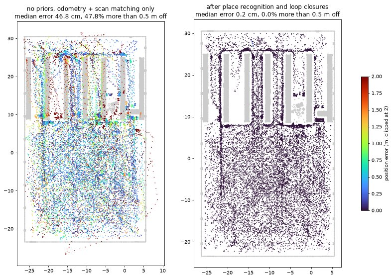

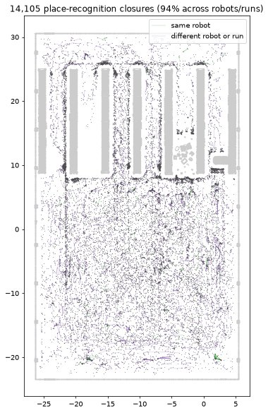

### Results

I compared three setups:

- **Priors** is round two's setup: the robot's own pose estimate on every capture, weighted loosely.
- **Segment starts** keeps that loose prior only on the first capture of each segment, where the robot
  (re)spawns. Nothing else has a prior.
- **Kidnapped** keeps it only on the first segment of each robot in each run. Every later respawn starts
  from an unknown spot, so place recognition has to work out where it is.

Errors are after a rigid 2D alignment to the truth. Anything more than 30 cm off is left out of the
alignment fit, so a few bad captures can't skew it.

| Setup | Median | 90th percentile | Max | More than 0.5 m off |
|---|---|---|---|---|
| Round two, priors | 2.9 mm | 6.5 mm | 1.5 cm | 0 |
| Round two, segment starts, no place recognition | 5 mm | | | 4.8% |
| Priors | 2.4 mm | 4.7 mm | 6.8 cm | 0 |
| **Segment starts + place recognition** | **2.5 mm** | **4.8 mm** | **1.1 cm** | **0** (99.8% kept) |
| Kidnapped + place recognition | 2.4 mm | 4.6 mm | (wrong place) | 0.25% (99.45% kept) |

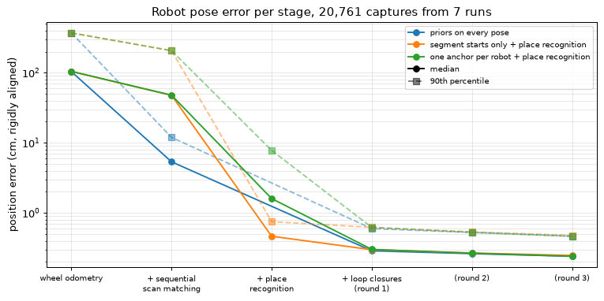

Without priors, sequential scan matching alone drifts badly (47 cm median, 9.5 m worst). Place recognition
pulls it in to 4.7 mm in one step, and the radius rounds polish it to 2.5 mm.

**Segments that never closed a loop.** The first version of this table showed 27.9 cm worst for
segment starts. That turned out to be two short forklift segments, 20 captures each, that never got a
single closure to any other segment. Without priors, nothing tied them to the map except their start
estimate, which is the robot's own guess and can be decimeters off. They were 8 and 28 cm off. They were
also the only segments in the whole graph with no closure to another segment, so the rule is simple and
needs no ground truth: a segment that never closed a loop with the rest of the map isn't part of the map.
That drops 40 captures (0.19%), and the worst case goes to 1.1 cm. That beats the worst case with priors
on every pose (6.8 cm). The 28 cm segment mattered more for the mesh than its size suggests. There's more on that
under Reconstruction.

By robot, the Carters come out at 2.7 mm median (7.8 mm worst) and the forklift at 1.8 mm (1.1 cm
worst).

### Kidnapped robots

The robots respawn when they get stuck or tip over, so the seven runs contain 274 separate segments. In
kidnapped mode, 35 of them keep their start estimate, one per robot per run, and the other 239 have to be
placed by place recognition.

A segment gets placed when at least two of its consistent closures, to segments that are already placed,
agree on where it started (within 0.5 m and 5°). Placing segments can chain: a segment placed this way can
then help place others. Any segment that never gets placed is dropped from the map.

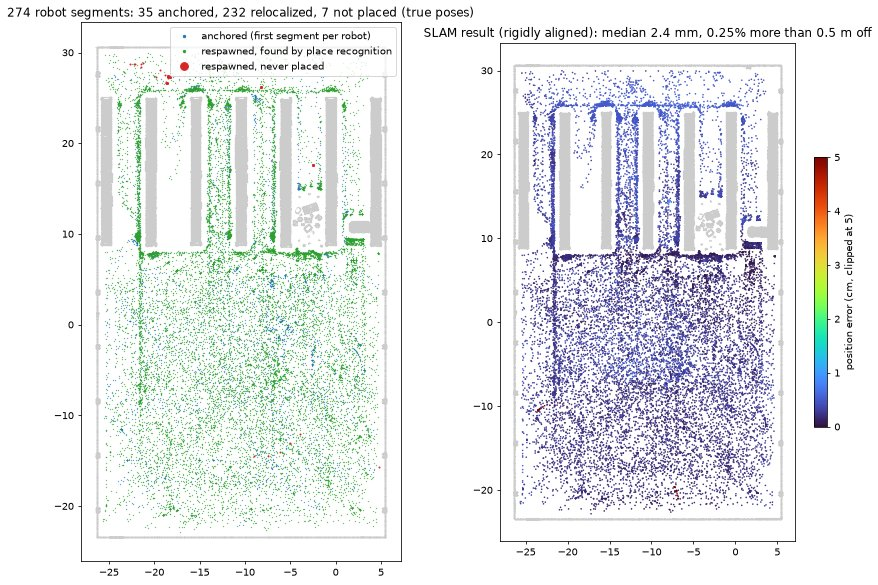

That placed 232 of the 239, so 99.45% of captures are in the map. The seven it couldn't place are short
segments that never got two consistent closures.

**Where it failed.** Two forklift segments, 51 captures or 0.25% of the total, were placed in the wrong
spot, tens of meters off. Both are on the big open floor south of the racks. The only structure there is
the wall, with a pilaster every 6 m or so, and from the middle of the floor one stretch of wall looks just
like the next. Two closures agreed with each other, and both were wrong. Once a segment is in the wrong
spot, the later radius rounds happily add more closures there, against the same repeating wall. One of
the two has 258 closures to 37 other segments. So I couldn't find a check that catches it after the fact.

Round two's version of this mode was much worse. The forklift only had planar scanners then, and their Scan Context was too
weak to tell places apart, so a lot of forklift segments got misplaced. The mast lidar fixed most of that.

## Fixing the forklift's scan matching

When I first switched the forklift over to the mast lidar for ICP, the median got better but the tail
blew up: some captures ended up 24–39 cm off. The mast's ±45° cone sees very little within a few meters,
so up close it's matching walls far away and the roof, and that's a weak constraint on position.

What works is a mix: the mast returns between 0.2 m and 4 m high with 3D normals, plus the three planar
layers with 2D normals. Scan Context and pole detection still use the full mast sweep.

## Stereo: left-right consistency

Round two found that almost half the bad stereo pixels within 6 m were on depth edges. That's mostly rack
uprights in front of a far background, where the depth smears off the upright into the gap behind it.

The usual fix is a left-right check. I run FoundationStereo a second time with the images mirrored and
swapped, which gives a disparity map for the right image. Then I warp that back into the left view and drop
any left pixel where the two disagree by more than 1 px. That doubles the stereo inference. With two
processes on each of seven GPUs, all 78,908 frames took about an hour and three quarters.

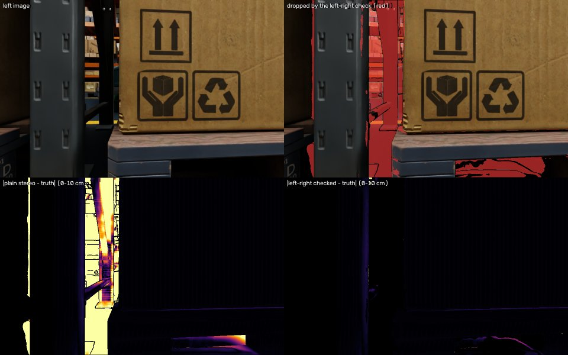

That's the failure, and the check takes it out. The red band down the right side of the upright is exactly
the smear.

Below, measured on a sample from every run:

| Within | Bad pixels (more than 5 cm off), plain | Checked | Pixels with a depth, plain | Checked |
|---|---|---|---|---|
| 4 m | 1.77% | **1.31%** | 91.3% | 89.8% |
| 6 m | 3.85% | **3.34%** | 91.9% | 90.5% |

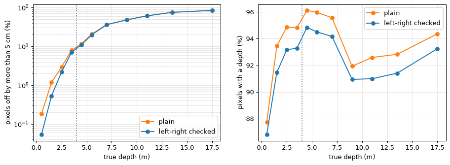

So about a quarter of the close-range bad pixels go away, and you lose about 1.5% of the pixels. Past 6 m
it does nothing, because the errors there are plain noise and not edge smears, and both images agree
on the wrong answer.

In the mesh, the check adds 1.5 points of accuracy (88.3% to 89.9% within 5 cm) and costs 1.2 points of
coverage. It's worth having, but most of the remaining stereo error is plain noise at range, and this
check can't see that.

## Landmarks: tried, and they made it worse

The idea was to detect rack uprights in each lidar sweep, track them as point landmarks, and add them
to the pose graph as extra constraints, to make it harder for a closure in a look-alike aisle to go wrong.

Detection works well enough. I look for isolated vertical columns in each sweep: at most 20 cm across, at
least six 15 cm height bins with returns in them, and nothing else tall within 35 cm. That gives about
6.5 poles per sweep, and they land where they should.

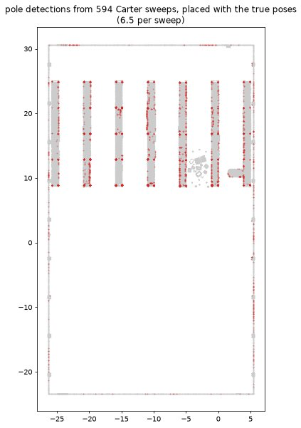

Detections from different sweeps are associated within 15 cm and kept if a pole was seen at least 5 times
from at least two segments. Each one becomes a 2D point node, with an edge to every pose that saw it, a
range-dependent uncertainty (3 cm + 0.5% of range) and a Cauchy robust kernel.

It hurt every time:

| Test | Without landmarks, median | With landmarks, median | 90th percentile, without → with |
|---|---|---|---|
| Round-two data, segment starts + place recognition | 5.1 mm | 6.9 mm | 8.8 mm → 3.5 cm |
| Round-three data, Carters | 4.2 mm | 14.3 mm | 6.9 mm → 3.8 cm |

The reason is simple once you look. Placed with the true poses, a given pole's detections are spread over
3.6 cm median (7.9 cm at the 90th percentile). Lidar only sees the near face of an upright, so the
centroid moves toward whichever side you're looking from, by up to half the post's width. ICP between full
sweeps is good to a few millimeters. Mixing in a constraint that's ten times noisier and biased by viewing
direction can only drag things off.

It might still be useful as a coarse check for place recognition, to reject a closure whose poles don't
line up, rather than as a pose constraint. Consistency checking already covers that, though. So landmarks
are off in the final model.

## Reconstruction

The recipe is round two's: layered stereo TSDF (2 cm voxels to 4 m, 4 cm voxels for 4–8 m that only fill
gaps), lidar as a third gap-filling layer, the free-space filter, and recoloring from the images. What's
new is the input: SLAM poses with no priors, left-right checked stereo, and the mast lidar in the lidar
layer.

Metrics are the same as round two:

- **Accuracy** is the share of the reconstructed surface within 5 cm of the true surface.
- **Completeness** is the share of the true surface with reconstruction within 5 cm, or 10 cm in the
  above-3 m column.

| Run | Median error | Within 2 cm | Accuracy | Whole building | Above 3 m |
|---|---|---|---|---|---|
| Upper bound: same recipe, true poses, rendered depth | 0.32 cm | 89.2% | 95.2% | 65.2% | 71.1% |
| Round-two final (priors, plain stereo, no mast lidar) | 0.60 cm | 75.0% | 88.9% | 64.0% | 69.0% |
| **Final: no priors, checked stereo, mast lidar** | **0.58 cm** | **75.7%** | **89.9%** | **63.0%** | **69.1%** |
| Same, true poses | 0.56 cm | 75.8% | 90.1% | 63.6% | 70.3% |
| Same, keeping the 2 segments with no closures | 0.64 cm | 72.8% | 86.7% | 63.4% | 70.2% |
| Same, plain stereo (no left-right check) | 0.61 cm | 74.2% | 88.3% | 64.2% | 69.6% |
| Same, without the mast lidar | 0.50 cm | 78.4% | 91.3% | 60.7% | 62.9% |
| Kidnapped (one anchor per robot per run) | 0.57 cm | 75.4% | 89.4% | 61.7% | 66.2% |

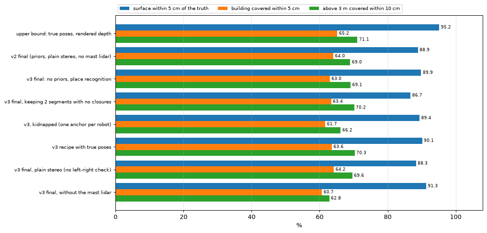

What I take from it:

- **Dropping the priors costs nothing.** The final model is within 0.2 points of its true-pose twin on
  accuracy, and within about a point on coverage. That's the main result of this round: round two
  needed the robots' own pose estimates to get here, and this one doesn't.
- **Even kidnapped is close.** With one start estimate per robot per run, it gets 89.4% accuracy. It loses a couple of
  points of coverage, mostly from the 0.55% of captures it couldn't place. The misplaced forklift segments
  hardly show up in the mesh. My guess is that's because they're tens of meters off, so their ghosts land
  in open space where other cameras look straight through them, and the free-space filter removes them.
- **A segment that's a little bit wrong is worse than one that's very wrong.** Keeping the two segments
  with no closures cost 3.2 points of accuracy, from 40 captures out of 20,761. The 28 cm-off one put
  about 290 m² of ghost wall just behind the real north and west walls. The free-space filter can't
  remove surface behind a wall, because no camera ray ever passes through it. And it's farther than 8 cm
  from the camera surface, so the lidar layer adds it as "new" surface.
- **The mast lidar is a trade.** It adds 6 points of coverage above 3 m (13 points at 6–9 m, 7 on the roof)
  and 2.3 on the whole building, and costs 1.4 points of accuracy. Lidar surfaces are lumpier than
  close-range stereo: at 15 m, 64 beams over 90° leave 20+ cm between rings.
- **The left-right check is a small win.** It gives 1.5 points of accuracy for 1.2 points of coverage, since
  fewer pixels means slightly fewer surfaces.
- **Overall it's level with round two, not better.** Each change helped on one axis and cost a bit on
  another. The point of this round was getting there without priors, and that worked.

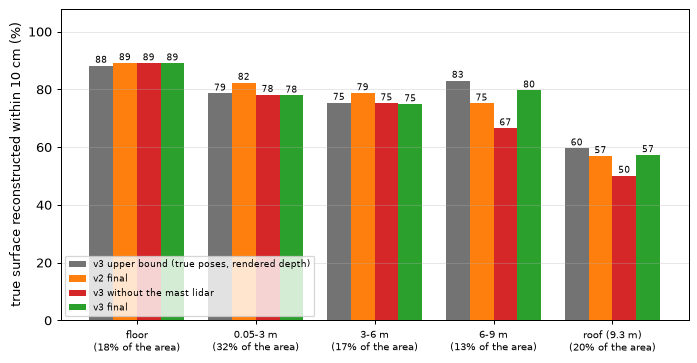

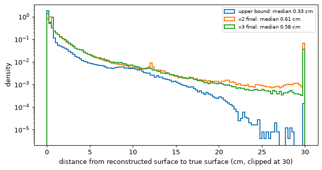

### The final model

From the same viewpoints, next to the true geometry (cropped at 6 m to take the roof off the right-hand
side):

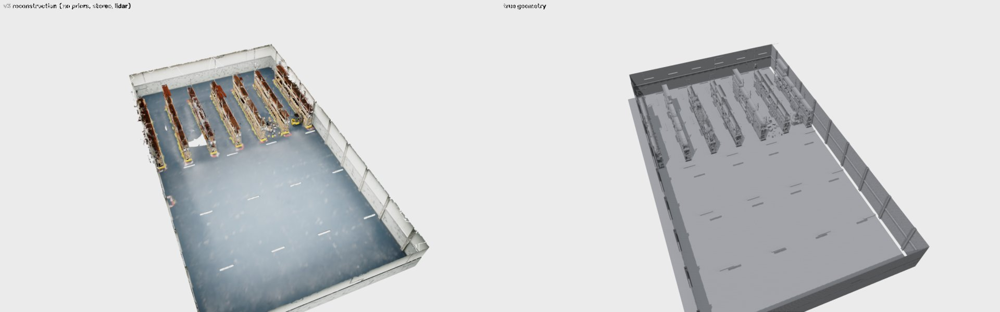

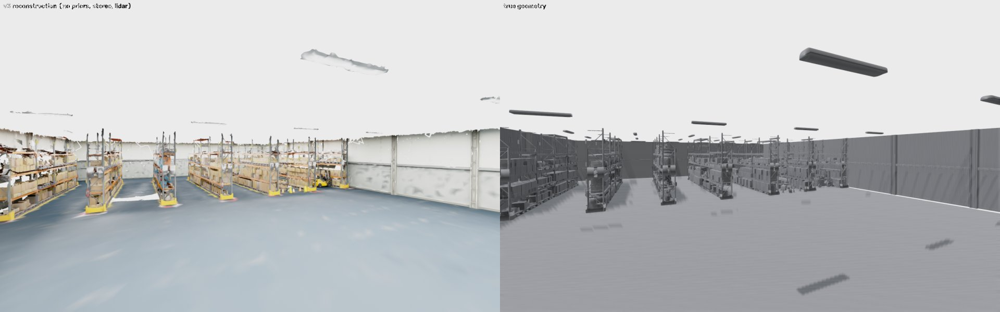

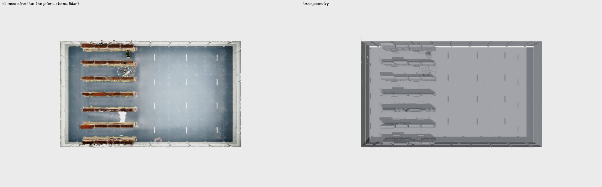

Colored by error, from 0 to 5 cm. Floors and walls are dark blue. The red is on the high rack faces at the
west end and on bits of the wall tops, which were only seen from a distance.

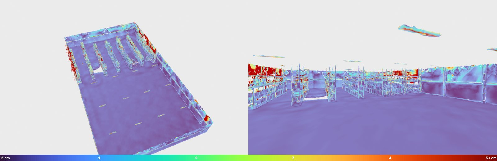

Round two (left, with priors) and round three (right, without) from the same spot:

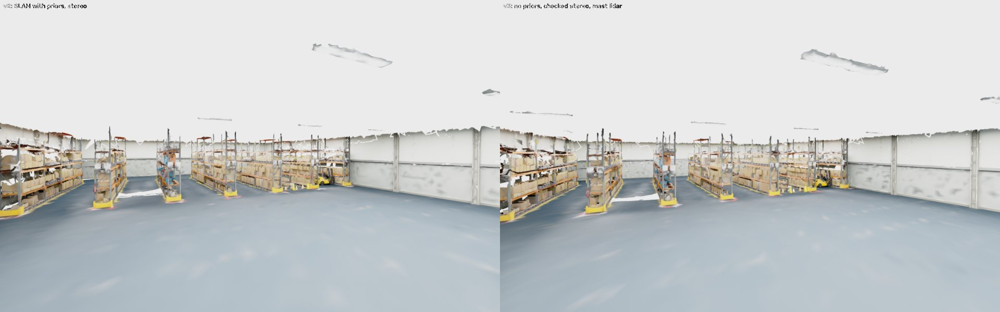

## Things that went wrong

- **A stale SLAM cache got reused.** The loader trusts any cache whose length matches the data. A rerun with
  landmarks turned off quietly loaded the landmark solution, and I spent a while puzzling over why
  nothing changed. I moved the caches aside and reran.
- **The left-right stereo outputs landed in the wrong folder** on the first try, so the first scoring
  found no files and reported nothing.
- **The forklift's mast-only ICP had a long tail**, as described above.
- **My first error alignment wasn't robust.** One misplaced segment in kidnapped mode dragged the whole
  alignment and made every capture look 6 cm off. Trimming the worst 30 cm out of the fit fixed it.
- **The evaluation's alignment was off by 2 cm.** A map built without priors sits in its own frame, so
  scoring starts by aligning it to the truth with ICP. A single pass with a 30 cm search radius settled 2 cm
  off, because it was pulled around by the noisy far surface. That made the first SLAM model look twice
  as bad as it was (1.2 cm median instead of 0.64). Tightening the ICP from coarse to fine (30, 10, 5, 3 cm)
  fixed it. Round two's maps had priors and sat within 3 mm of the true frame, so its numbers stand.
- **Two unverified segments cost 3 points**, as described above. I only found them because the first
  model was 3 points worse than its true-pose twin and the poses looked perfect. The worst ones didn't
  show up in the median pose error at all.
- **Fusion is slow.** Each run is about 3 hours of CPU-bound TSDF fusion over 28 tiles. I ran six at once
  on 184 cores, which put the load at around 380, and then had to redo three after the segment fix.

## Caveats

- **It's still a sim.** Clean rendered images, perfect lighting, no motion blur, and Gaussian lidar
  noise. The left-right check works better on clean images than it would on real ones with glare or
  low texture.
- **Kidnapped mode still needs a start estimate for one segment per robot per run.** Fully cold starts would need a way to
  agree on a shared frame with no anchor at all. That works in principle, but I didn't test it.
- **Big empty floor with repeating walls is still a weak spot** for place recognition, as the two misplaced
  forklift segments show.
- **Calibration is given**, and moving things are masked with the sim's segmentation. Same as round two.

## What I'd do next

1. **Make place recognition care about uncertainty on open floor.** Reject a closure when the descriptor's
   second-best match is nearly as good as its best. On a wall that repeats every 6 m, that should be the
   case, so it might have caught both pilaster mismatches. I haven't tested it.
2. **Stereo confidence instead of a hard check.** FoundationStereo's own uncertainty, or the left-right gap
   as a weight in the TSDF, so marginal pixels count for less instead of being thrown out.
3. **Use the mast lidar only where the cameras can't reach.** It costs 1.4 points of accuracy on surfaces
   the stereo already covers. Using it only above 3 m, or capping it at 12 m, should keep most of the
   high coverage for less of that cost.
4. **Shorter fusion.** The 28-tile TSDF is CPU-bound. Moving integration to the GPU (Open3D's CUDA TSDF)
   would turn hours into minutes and make ablations cheap.

## Files and how to reproduce

On the box:

- `~/warehouse_amr/recon/warehouse_recon_v3.glb` and `warehouse_recon_v3_lite.glb`: the model.
- `~/warehouse_amr/recon/v3/out_final/`: meshes, `metrics.json`, `poses.npy`.
- `~/warehouse_amr/recon/v3/out_*`: the ablation runs.
- `~/warehouse_amr/recon/v3/slam_pr_poses.npy` (segment starts), `slam_kidnap_poses.npy` and
  `slam_poses.npy` (priors): the cached SLAM solutions, each with per-stage poses, closures and the
  localized mask next to it.

Code, in `~/isaacsim/tools/warehouse_amr/`:

- `collect_recon.py`: drive the fleet and log captures (now with the forklift mast lidar).
- `stereo_depth.py`: FoundationStereo, with `--lr` for the left-right check.
- `slam.py`: the pose graph, with Scan Context, consistency checking, kidnapped placement, the
  "no closure to another segment means not in the map" rule, and the pole landmarks (off by default).
- `recon.py`: fuse, filter, recolor, evaluate and export. SLAM modes are picked with `--poses`:
  `slam` (priors), `slam_pr` (segment starts), `slam_kidnap`, plus `_lm` variants with landmarks.
- `~/warehouse_amr/recon/report_v3/make_media_v3.py`: the figures and the fly-through.

```bash
cd ~/isaacsim
V=~/warehouse_amr/recon/v3

# collect, one run per GPU (seeds 31-37)
./python.sh tools/warehouse_amr/collect_recon.py --gpu 2 --seed 31 --steps 6000 --out $V/data_s31

# stereo depth with the left-right check (writes *_sl.png next to the plain *_s.png)
CUDA_VISIBLE_DEVICES=2 ~/.venvs/stereo/bin/python tools/warehouse_amr/stereo_depth.py $V/data_s3* \
    --iters 12 --lr --lr-tol 1.0 --suffix _sl --plain-suffix _s --shard 0/14

# SLAM (segment starts + place recognition) + fuse + recolor + evaluate + export
~/.venvs/recon/bin/python tools/warehouse_amr/recon.py $V/data_s3{1,2,3,4,5,6,7} \
    --poses slam_pr --slam-cache $V/slam_pr_poses.npy --stereo-suffix _sl \
    --depth stereo --depth-near 4 --depth-max 8 --far-voxel 0.04 --color-max 20 \
    --lidar-fuse --free-space --out $V/out_final

# previews and media
~/.venvs/recon/bin/python tools/warehouse_amr/recon_views.py $V/out_final --gt $V/data_s31/gt_mesh.npz
cd ~/warehouse_amr/recon/report_v3 && ~/.venvs/recon/bin/python make_media_v3.py all
```
